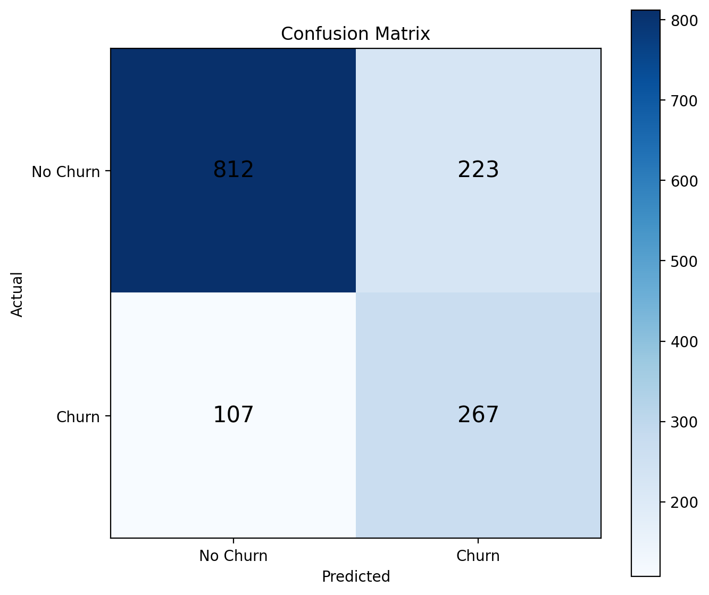
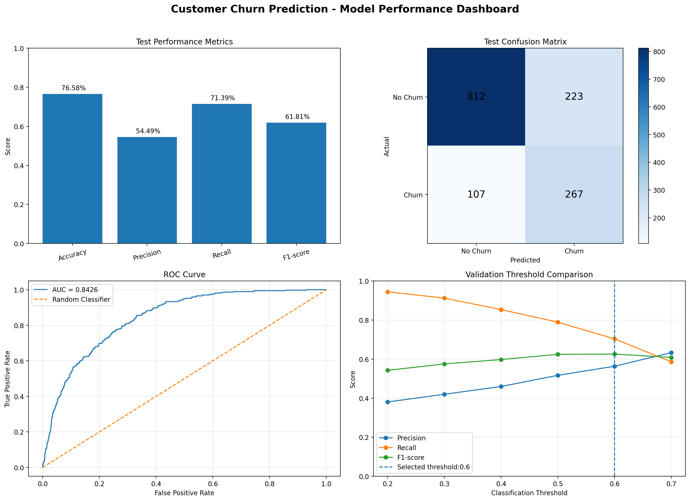

# Customer Churn Prediction

An end-to-end machine learning project that predicts customer churn using Python and Scikit-learn, with Amazon S3 artifact storage and a prepared Amazon SageMaker training workflow.

> **Project status:** The local Scikit-learn training and prediction workflow is implemented. AWS S3 integration is implemented. Model training and evaluation have been reproduced successfully in Google Colab. The SageMaker training request was prepared and inspected with a dry run; a managed SageMaker training job has **not** been confirmed as successfully completed.

## Overview

Customer churn occurs when a customer stops using a service. Identifying customers who may churn can help businesses prioritize retention efforts and improve customer relationships.

This project builds a binary classification pipeline using the Telco Customer Churn dataset. It includes:

- Data inspection and validation
- Numeric and categorical preprocessing
- Logistic Regression with class weighting
- Stratified train, validation, and test splitting
- Decision-threshold selection using validation F1-score
- Evaluation on an untouched test set
- Model serialization using Joblib
- Model and metrics download from Amazon S3
- Batch predictions for new customer records
- A prepared Amazon SageMaker training configuration
- Model evaluation visualizations

## Technologies Used

| Technology | Purpose |
|---|---|
| Python | Programming language |
| Pandas | Data manipulation |
| Scikit-learn | Machine learning and preprocessing |
| NumPy | Numerical operations |
| Matplotlib | Evaluation visualizations |
| Joblib | Model serialization |
| Amazon S3 | Model and metrics artifact storage |
| AWS CLI | AWS resource access |
| Amazon SageMaker | Prepared managed training workflow |
| Google Colab | Model training and evaluation environment |
| Git and GitHub | Version control and project hosting |

## Repository Structure

```text
.
├── data/
│   └── input/
│       └── new_customer.csv
│
├── reports/
│   ├── metrics.json
│   ├── confusion_matrix.png
│   ├── roc_auc.png
│   └── performance_dashboard.png
│
├── src/
│   ├── download_model.py
│   ├── inspect_data.py
│   ├── predict.py
│   ├── run_sagemaker.py
│   ├── sagemaker_train.py
│   └── train.py
│
├── .env.example
├── .gitignore
├── README.md
└── requirements.txt
```

The raw training dataset and trained model artifacts are intentionally excluded from the public repository.

The training scripts expect the source CSV file at:

```text
data/raw/telco-churn.csv
```

## Machine Learning Workflow

The project follows an end-to-end supervised machine learning workflow.

1. Load the Telco Customer Churn dataset and validate required columns.
2. Convert `TotalCharges` into numeric values.
3. Handle missing values through preprocessing pipelines.
4. Remove `customerID` from the model features.
5. Encode the target variable:
   - `No = 0`
   - `Yes = 1`
6. Split the dataset into training, validation, and test sets using stratified sampling.
7. Impute numeric features using the median and standardize them.
8. Impute categorical features using the most frequent value and apply one-hot encoding.
9. Train a class-weighted Logistic Regression classifier.
10. Compare classification thresholds using validation-set precision, recall, and F1-score.
11. Select the threshold with the highest validation F1-score.
12. Evaluate the selected model on the untouched test set.
13. Save the trained pipeline and evaluation metrics.

### Data Splitting

The default training workflow uses the following split:

| Dataset | Percentage | Records |
|---|---:|---:|
| Training | 60% | 4,225 |
| Validation | 20% | 1,409 |
| Testing | 20% | 1,409 |
| **Total** | **100%** | **7,043** |

Stratified splitting is used to preserve the target-class distribution across the three datasets.

### Preprocessing

The project uses Scikit-learn pipelines and a `ColumnTransformer` to apply different preprocessing strategies to numeric and categorical features.

**Numeric features:**
- Median imputation
- StandardScaler normalization

**Categorical features:**
- Most-frequent-value imputation
- OneHotEncoder with `handle_unknown="ignore"`

Preprocessing is fitted using the training data through the machine learning pipeline, helping prevent data leakage.

### Model

The baseline classifier is Logistic Regression with class weighting.

```python
LogisticRegression(
    max_iter=1000,
    class_weight="balanced"
)
```

Class weighting helps account for the imbalance between churn and non-churn customers.

## Decision Threshold Selection

The model generates churn probabilities. Instead of relying on the default classification threshold of 0.50, this project evaluates multiple candidate thresholds using validation data.

Candidate thresholds:

```python
[0.20, 0.30, 0.40, 0.50, 0.60, 0.70]
```

The threshold is selected by maximizing the validation F1-score.

### Selected Threshold

**0.60**

Validation performance at the selected threshold:

| Metric | Validation Score |
|---|---:|
| Precision | 56.30% |
| Recall | 70.30% |
| F1-score | 62.50% |

The threshold is a decision-policy choice. In a real business environment, it should also be evaluated against the financial and operational costs of missed churn customers and unnecessary retention interventions.

## Model Evaluation Results

The latest reproduced training run was performed in Google Colab using the project's existing training pipeline and dataset.

The model was evaluated on an untouched test set containing 1,409 customer records.

### Test Set Performance

| Metric | Test Score |
|---|---:|
| Accuracy | 76.58% |
| Precision | 54.49% |
| Recall | 71.39% |
| F1-score | 61.81% |
| ROC-AUC | 84.26% |
| Selected threshold | 0.60 |

### Confusion Matrix

The following confusion matrix was obtained from the final test evaluation.

| | Predicted No Churn | Predicted Churn |
|---|---:|---:|
| Actual No Churn | 812 | 223 |
| Actual Churn | 107 | 267 |

Interpretation:

- **True Negatives (812):** Customers correctly predicted not to churn.
- **False Positives (223):** Customers predicted to churn who did not churn.
- **False Negatives (107):** Customers who churned but were predicted not to churn.
- **True Positives (267):** Customers correctly predicted to churn.

The model identifies approximately 71% of actual churn customers in the test set.

### Evaluation Visualizations

The following visualizations summarize the model's test performance and validation threshold selection.

#### 1. Confusion Matrix



#### 2. ROC Curve


The ROC-AUC score of 0.8426 indicates that the model has good discriminative ability on the held-out test set.

#### 3. Model Performance Dashboard



The dashboard combines:

- Test performance metrics
- Confusion matrix
- ROC curve
- Validation threshold comparison

### Evaluation Notes

The final test F1-score of 61.81% is close to the validation F1-score of 62.50%.

This is encouraging evidence of reasonably consistent performance across the validation and test sets. However, further evaluation is necessary before considering the model suitable for real-world business decisions.

These metrics represent the latest reproduced training run. Results may differ if the dataset, code, preprocessing, or experimental configuration changes.

## Installation

### Requirements

- Python 3.10 or later
- pip
- Git
- An AWS account for S3 workflows
- AWS CLI configured with appropriate permissions for S3 operations

For SageMaker workflows, an appropriate SageMaker execution role and the required AWS account permissions are also necessary.

### Clone the Repository

```bash
git clone https://github.com/yukiUv/aws-customer-churn-prediction-ml-01-uw.git

cd aws-customer-churn-prediction-ml-01-uw
```

### Create a Virtual Environment

**Windows PowerShell:**

```powershell
python -m venv .venv

.\.venv\Scripts\Activate.ps1
```

### Install Dependencies

```bash
python -m pip install --upgrade pip

pip install -r requirements.txt
```

## Prepare the Dataset

Obtain a lawful copy of the Telco Customer Churn dataset and place it at:

```text
data/raw/telco-churn.csv
```

The dataset should contain the required columns, including:

- `customerID`
- `TotalCharges`
- `Churn`

### Inspect the Dataset

Run:

```bash
python src/inspect_data.py
```

This script helps inspect the source dataset before model training.

## Train the Model Locally

Run:

```bash
python src/train.py
```

The training script performs preprocessing, model training, validation threshold selection, and final test evaluation.

Expected generated artifacts:

```text
models/
└── churn_pipeline.joblib

reports/
└── metrics.json
```

The `models/` directory and local model artifacts are excluded by `.gitignore`.

## Google Colab Training

The project can also be executed in Google Colab.

The repository can be cloned directly into a Colab notebook:

```python
!git clone https://github.com/yukiUv/aws-customer-churn-prediction-ml-01-uw.git
```

Navigate to the project directory:

```python
%cd /content/aws-customer-churn-prediction-ml-01-uw
```

Install dependencies:

```python
!pip install -r requirements.txt
```

Ensure the dataset is available at:

```text
data/raw/telco-churn.csv
```

Run the training script:

```python
!python src/train.py
```

The resulting model and metrics can be used to generate the evaluation visualizations stored in the `reports/` directory.

## Run Batch Predictions Using S3 Artifacts

The prediction workflow uses model artifacts stored in Amazon S3.

The scripts read AWS configuration from environment variables.

Copy `.env.example` to `.env` for your own reference. PowerShell does not automatically load `.env` files, so set the required variables in your current session.

**Windows PowerShell:**

```powershell
$env:S3_BUCKET = "your-s3-bucket-name"

$env:AWS_REGION = "ap-southeast-2"

$env:AWS_PROFILE = "your-aws-cli-profile"
```

Ensure that your AWS CLI profile is configured and has permission to download the required model and metrics objects.

Download the model:

```bash
python src/download_model.py
```

Run batch predictions:

```bash
python src/predict.py
```

The prediction script reads:

```text
data/input/new_customer.csv
```

It generates:

```text
reports/churn_predictions.csv
```

The output contains the input customer features, estimated churn probabilities, and predicted churn classifications.

## Amazon SageMaker Workflow

The repository includes a prepared SageMaker training workflow.

Components:

- `src/sagemaker_train.py`: SageMaker-compatible training entry point.
- `src/run_sagemaker.py`: Builds and inspects a SageMaker training request.

Set the required environment variables before preparing the request.

**Windows PowerShell:**

```powershell
$env:S3_BUCKET = "your-s3-bucket-name"

$env:AWS_REGION = "ap-southeast-2"

$env:AWS_PROFILE = "your-aws-cli-profile"

$env:SAGEMAKER_ROLE_ARN = "arn:aws:iam::ACCOUNT_ID:role/NAME_SAGEMAKER_ROLE"
```

Run:

```bash
python src/run_sagemaker.py
```

This script prepares and inspects the training configuration. It does not submit a managed SageMaker training job.

A successful dry run is not proof that a managed training job can be launched.

Actual execution requires appropriate IAM permissions, a SageMaker execution role, access to Amazon S3 and Amazon ECR, and any required networking and account-level permissions.

Review AWS permissions and potential service costs before submitting a managed training job.

## Configuration and Security

Security is an important consideration when working with cloud-based machine learning projects.

- Never commit AWS access keys, secret keys, session tokens, private keys, or `.env` files.
- Use named AWS CLI profiles or IAM roles rather than embedding credentials in source code.
- Keep raw customer datasets and generated customer prediction outputs out of public Git history.
- Use `.env.example` only for placeholder variable names and example values.
- Review `.gitignore` before committing project changes.
- If credentials have ever been committed, rotate or revoke them immediately. Removing them from the latest commit does not remove them from Git history.

## Limitations and Future Improvements

This project currently provides a Logistic Regression baseline for customer churn prediction.

Potential improvements include:

- Experiment with Random Forest, XGBoost, and other classification algorithms.
- Perform hyperparameter optimization.
- Evaluate business-specific classification thresholds using cost-sensitive evaluation.
- Investigate feature importance and model interpretability.
- Validate model performance across customer segments.
- Introduce time-based validation to evaluate performance on future customers.
- Add automated unit and integration tests.
- Implement experiment tracking and model versioning.
- Add data and model drift monitoring.
- Develop a production inference API or deployment endpoint.
- Complete and validate an actual managed SageMaker training run.

The current model should not be considered a production-ready churn decision system without further validation.

## License

No license is currently specified for this repository.

A license should be added after deciding how others may use, modify, and redistribute the project.

---

**Project Repository:**  
https://github.com/yukiUv/aws-customer-churn-prediction-ml-01-uw

**Author:** Chandima Udugama Withanage
